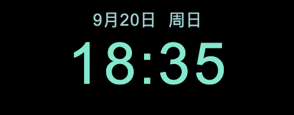
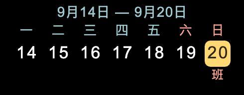
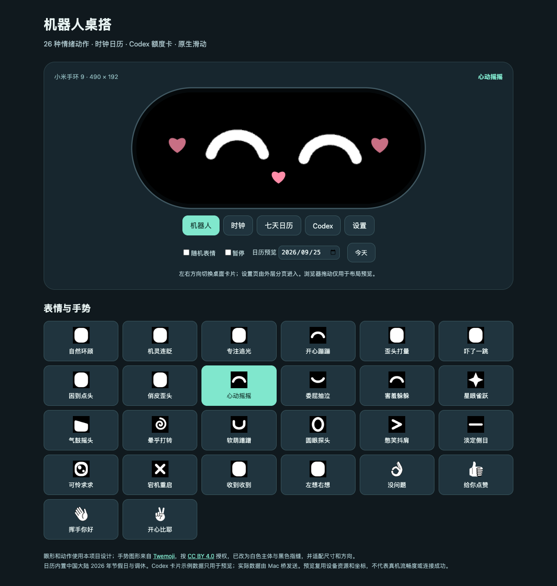

<div align="center">


# 机器人桌搭 · Band Desk

**让小米手环变成桌面上的小机器人。**

表情 · 时钟 · 日历 · Codex 额度

[功能介绍](#能做什么) · [开始使用](#开始使用) · [Codex 额度](#codex-额度可选) · [开发文档](docs/README.md)

</div>

机器人桌搭是一个面向 **Xiaomi Smart Band 9 NFC** 的 Vela JS 快应用，将手环横放后作为桌面小屏使用。项目还提供可选的 macOS 菜单栏桥和 AstroBox 插件，用于显示 Codex 额度。

> 这是独立的个人项目，与 Xiaomi、OpenAI 或 AstroBox 官方无关联。它是手环快应用，不是 Android APK，也不修改设备固件。

## 看一眼

<table>
  <tr>
    <td align="center"><br /><b>机器人表情</b></td>
    <td align="center"><br /><b>大字时钟</b></td>
  </tr>
  <tr>
    <td align="center"><br /><b>每周日历</b></td>
    <td align="center"><br /><b>Codex 额度</b></td>
  </tr>
</table>

图片来自项目的预览或测试画面，日期和额度为示例；外观、动画和可用性以实际设备为准。[打开本地交互预览](#浏览器预览)。

### 表情预览

预览页可以逐一查看 26 种表情与手势，下图展示“心动摇摇”的浏览器预览画面。



## 能做什么

- **机器人表情**：26 组表情和短动作，点击眼睛获得回应。
- **桌面信息**：左右切换表情、大字时钟、本周日历和 Codex 额度。日历的中国大陆法定节假日及调休数据目前只核对至 **2026 年**。
- **自动切换**：默认开启；表情页约 60 秒，其余页面各约 10 秒。手动操作后留出阅读时间，也可以在设置中关闭。
- **桌面设置**：上滑进入设置，下滑返回；可设置常亮 30 分钟或 2 小时，并通过确认页退出。
- **Codex 额度**：可选显示剩余额度、重置时间和数据状态；在额度页双击请求刷新。Mac 桥不可用时其他桌面仍可使用。

## 设备支持

| 项目 | 当前范围 |
| --- | --- |
| 已使用设备 | Xiaomi Smart Band 9 NFC（M2346B1），系统 3.1.32 |
| 显示 | 192 × 490 物理屏幕，横屏桌面 |
| 其他设备 | 尚未验证，屏幕尺寸、系统和接口兼容性可能不同 |
| 版本 | 手环源码 0.9.2 / versionCode 21；Mac 桥 0.8.2；AstroBox 插件 0.7.6 |

上述设备安装和 Codex 回执曾在一套真实环境中确认；新开关的使用体验、长期连接恢复和功耗仍需进一步验证。详见[交接记录](docs/handoff.md)与[验证记录](docs/validation.md)。

## 开始使用

### 1. 准备 RPK

如果已有可信来源的本项目 RPK，可跳到下一步。也可以从源码构建：

```bash
npm ci
npm test
npm run build
```

需要 Node.js 20+、npm 和 Python 3；`npm run build` 生成并校验 `dist/` 下的 RPK。开发构建会优先使用本地 `sign/debug/` 或 `sign/` 中的签名，未提供时工具链使用自带的开发证书；正式构建需要自行准备签名。**不同签名的包可能无法覆盖安装**，请安全保管自己的签名，切勿提交私钥。依赖、资源生成及环境说明见[开发指南](docs/development-guide.md)。

### 2. 连接手环并安装

手环的连接、配对和 RPK 安装可根据自己的设备与环境选择合适的工具，以下资料可供参考：

- [xiaomi-band9-mcp](https://github.com/Soodok/xiaomi-band9-mcp)：小米手环 9 连接及 RPK 管理的社区项目。
- [米坛社区 BandBBS](https://www.bandbbs.cn/)：查找对应型号的教程、工具和讨论。
- [AstroBox 连接说明](https://abox.run/docs/usage/connection)：本项目开发时使用过的方案之一。

请以所选工具的最新说明和设备实际情况为准；以上项目各自独立，本项目没有验证它们的所有版本或连接组合。安装后从手环应用列表打开“机器人桌搭”。如果使用本仓库的 AstroBox 安装脚本，先阅读[设备部署说明](docs/device-setup.md)，确认目标设备与安装队列。不要分享账号密码、设备密钥或签名私钥。

## Codex 额度（可选）

只使用表情、时钟和日历不需要 Mac 桥。显示 Codex 额度时，当前实现需要 **macOS、已登录的 Codex、AstroBox 及其插件**：

```text
Codex App Server → macOS 菜单栏桥 → AstroBox 插件 → 手环
```

1. 确认手环已安装并打开本项目快应用，AstroBox 已连接该手环。
2. 按 [Mac 桥说明](macos/BandDeskBridge/README.md) 构建并运行菜单栏 App。
3. 按 [插件说明](astrobox-plugin/band-desk-bridge/README.md) 构建 `.abp`，在 AstroBox 中导入并启用插件。
4. 在菜单栏查看连接状态；手环额度页可双击请求刷新。已发送和手环已确认是不同状态，断连或数据过期时页面会提示。

Mac 桥仅监听 `127.0.0.1:17373`，转发额度和用量汇总字段；不读取或保存 Codex 登录令牌。当前插件与 AstroBox 2.1 的链路曾取得真实手环 ACK，其他安装工具不一定提供此桥接功能。[数据流与协议](docs/codex-macos-plan.md)

## 浏览器预览

在项目目录启动本地服务：

```bash
python3 -m http.server 8770 --bind 127.0.0.1
```

然后打开 [机器人桌搭预览](http://127.0.0.1:8770/design/robot-desk/v5/index.html)。预览使用示例数据，不连接手环；浏览器渲染和滑动效果不能代表真机性能。[预览说明与素材来源](design/robot-desk/README.md)

## 参与开发

项目目录：`src/` 为手环快应用，`macos/BandDeskBridge/` 为 Mac 菜单栏桥，`astrobox-plugin/` 为转发插件，`design/` 为预览，`docs/` 为开发与验证记录。

- [文档导航](docs/README.md) · [开发指南](docs/development-guide.md) · [验证清单](docs/release-checklist.md)
- [当前交接](docs/handoff.md) · [技术方案](docs/robot-technical-plan.md) · [版本记录](docs/version-history.md)
- 提交问题时请注明设备型号、系统、应用版本、复现步骤和预期结果；分享日志与截图前请移除账号、设备标识和其他敏感信息。

## 许可与致谢

项目原创代码和文档使用 [MIT License](LICENSE)：允许使用、修改和分发（包括商业用途），但需保留版权和许可声明。第三方素材、商标及依赖按各自条款使用；本项目的 MIT 许可不授予其额外权利。

手势图形基于 [Twemoji](https://github.com/twitter/twemoji)（CC BY 4.0），历史预览包含 MIT 许可的 Grobot 改编；OpenAI 标识和字体亦有各自的权利边界。来源、适用范围及再分发说明见[第三方许可与素材说明](THIRD_PARTY_NOTICES.md)。
