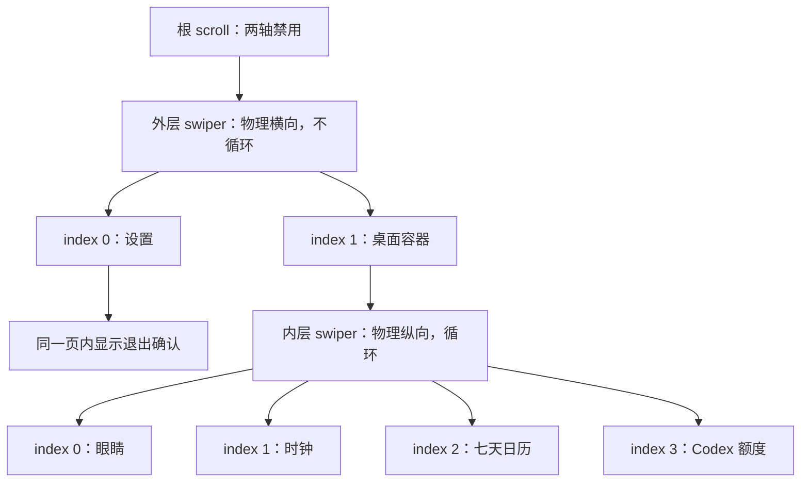

# 当前技术方案

状态：2026-09-23 / 手环源码 0.9.2 / versionCode 21，修复 Pro 20×／Pro 5× 档位显示；Mac 0.8.2 同步名称，插件沿用 0.7.6。沿用 v18 已接受的黑底额度环与 v20 自动切换开关；安装与真实回执状态见 [handoff.md](handoff.md)。

## 产品约定

默认白色机器人眼睛，不叠文字和按钮；点击回应，定时随机换表情。左右在眼睛、时钟、本周七天日历、Codex 额度卡之间循环；上滑设置，下滑回原桌面。设置只保留常亮和退出，退出需左叉取消／右勾确认。没有翻转按钮。

字体和主要 UI 要大，删除无意义提示。所有内容可使用整个 490×192 胶囊，按弧线适配而非统一内缩。眼睛与四种手势统一白色，手势保留黑色指缝；时钟薄荷青、今天暖金、调休上班珊瑚色，爱心／眼泪等点缀可以保留彩色。

26 种表情各有短动作：环顾和追踪、歪头打量、开心双跳、惊讶回弹、困倦点头、俏皮单眨、心动摇摆、委屈抽泣、害羞躲闪、气鼓摇头、晕乎绕圈等。四手势分别配合 OK 点头、点赞上提、连续挥手和比耶双跳。动作包含起势、回应、回位和停顿；不全程漂移，也不只更换眼形后重复同一眨眼。

## 页面与状态

设备入口 [index.ux](../src/pages/index/index.ux) 直接使用预旋转图片和物理矩形。没有 runtime transform，没有旧 JS front/incoming 双卡，也没有独立全屏输入层。

| 状态／事件 | 责任 |
| --- | --- |
| outerIndex、deskIndex | 原生分页选择；change 回调同步索引 |
| confirming | 设置页内的确认界面显隐；不新增第三个外层分页 |
| view、homeView | syncView 从索引推导当前业务视图和返回桌面 |
| touchstart | 暂停眼睛属性更新，记录触摸和刷新防误触状态 |
| touchmove | 判断是否移动、延长防误触／恢复期限；不改变页面位置 |
| swipestart/end | 暂停／恢复眼睛，处理拖动结束；保留缺失事件恢复 |
| onBackPress | 返回 true，打开设置 |
| hide/destroy/exit | 清理 ticker、眼睛和恢复任务，释放常亮 |

clockSprites、calendarSprites 和 codexSprites 在首次数据就绪时准备，之后按内容签名更新；不会在首次 move 创建目标页。Codex 快照按 session／revision 防止倒序覆盖，写入 storage，10 分钟后明确标记过期；整卡双击只发请求，不伪造成功状态，loading 只换独立小图。设置底图常驻，状态图变化不重建图片数组。原生嵌套手势已在 PRE 4.0 检查；v15 四页结构获用户整体正常反馈，v16 新视觉仍待真实 3.1.32 验收。

### 调度参数

| 参数 | 当前实现 | 解释 |
| --- | --- | --- |
| swiper duration | 160ms | 原生配置值，不是测得的设备响应时间 |
| 眼睛运动段更新预算 | 1000/60ms | 按经过时间采样、跳过迟到帧，只写变化属性；不是实测显示 FPS |
| 静止段唤醒 | nextMotionDelay | 按眼睑、gaze 和效果各自曲线找下一变化段，最长 1000ms 后复查，保持一个有界动作定时器 |
| 自动情绪更换 | scene.duration × 2，当前 8～12.8 秒 | 未被触摸或生命周期打断时播放两个完整周期；随机避免相邻重复，不保证遍历所有情绪后才重复 |
| pending 文案 | 请求超过 120ms 才显示 | 快速回调不闪出“申请中” |
| 触摸结束恢复任务 | 220ms | 有界恢复眼睛调度；不是切页定时器 |
| 丢失事件保护 | 最后事件后设 1200ms 期限 | 由每秒 refresh 检查，实际恢复还取决于回调调度，不是硬实时上限 |

拖动完成阈值和惯性由原生 swiper 决定。`animation.js` 中的 slidePair、dragDestination 等旧辅助函数仍服务浏览器预览；不得误接回设备导航，造成一次手势执行两次切换。

## 绘制与资源

逻辑 `[x,y,w,h]` → 默认物理 `[192-y-h,x,h,w]`。显示和点击共用 [layout.js](../src/common/layout.js) 的 BOXES；图库包含 forward/reverse，但设备 UI 当前只用默认方向。日期字形等无点击内容由 [physical-ui.js](../src/common/physical-ui.js) 排布。

- 眼睛：128×128 固定槽、白色眼形、黑色眼睑和最多三个效果节点。眼睑用整数厚度、非零几何，睁开设透明；场景切换清掉旧粒子。26 种表情均有独立短动作，gaze 的 `[percent,x,y,tilt]` 只改变坐标，tilt 表示左眼减 y、右眼加 y 的高低差，不使用原生旋转。
- 效果：`[percent,scale,y,opacity,x]` 曲线保持 scale=1，只移动和改变透明度，不逐帧缩放图片。可独立指定 duration；followGaze 令腮红／眼泪等贴脸效果跟随对应眼睛。四个白色手势固定 76px，收在胶囊末端内，双眼先左移再显示手势；结束隐藏后双眼回位。
- 时钟：96px 数字、28px 日期标题；字形预旋转。字体定义在 [physical-assets.mjs](../scripts/physical-assets.mjs)，未收录的新字符会使 textRun 排布时找不到对应字形，必须同步补充并生成资源。
- 日历：七列，26px 星期、34px 日期、24px 底栏。底栏 `festival || mark`；节日当天不再并列显示休，连续 mark=休 的格子使用 start/middle/end/single 底图衔接。普通周末无官方 mark 时不画假期条。
- Codex：纯黑底，无装饰背景和描边卡片；左侧绿色额度环配白色数字，右侧 ChatGPT Logo、实际订阅档位、重置时间和更新状态；文字全行预排版、统一左对齐，隐藏双击提示。断连／过期保留显式状态；独立小图 loading。
- 设置：单张 192×490 固定底图包含常亮／自动切换／退出三项文字及轮廓；两个内部值图各为 40×112 物理尺寸，`object-fit:none`。设置生成器直接使用 BOXES 的轮廓和值图尺寸，保持显示与命中区域一致。
- 确认页：左右 92×192 逻辑端部叉／勾，中间 36px 文案。仅右勾确认调用 terminate。
- 启动器：192×156 瓦片，96px 标记和可见应用名；更名同时改 manifest 和重新生成入口图。

当前清单为 27 张机器人原图、432 张预旋转资源、26 个情绪；这是本次基线，不应硬编码为未来扩展上限。生成源和流程：

| 手工维护源 | 生成结果／消费者 |
| --- | --- |
| scripts/robot-scenes.mjs | src/common/robot-scenes.js；眼形、曲线、效果定义 |
| design/robot-desk/v3/sprites.html、scripts/vendor/twemoji | 原图 src/common/robot；v3 虽为历史预览目录，sprites.html 仍是生成输入，不可按旧目录删除 |
| scripts/physical-assets.mjs、scripts/generate-physical.mjs | physical 图片、physical-glyphs.js、physical-inventory.json |
| scripts/generate-preview.mjs | v5/shared.js，拼接共享布局、数据和插值 |
| scripts/generate-launcher.m | common/launcher-band9.png |

Twemoji 图形采用 CC BY 4.0，包内保留 [署名](../src/common/licenses/Twemoji-NOTICE.txt) 和 [许可](../src/common/licenses/Twemoji-LICENSE.txt)。原始 SVG 保留不改，`sprite-catalog.mjs` 在构建时改为白色与黑色手指细节，去掉原图挥手标记并补充拇指分界；修改说明随包保留。RoboEyes 只参考交互概念，没有复制 GPL 源码。历史 Grobot 原型的实际复用及 MIT 许可见设计目录，不把它描述为 xAI 官方实现。

## 常亮与系统能力

[keep-screen.js](../src/common/keep-screen.js) 保存 deadline、visible 和请求 revision。选择时设置期限；hide 保留期限但请求关闭，show 仅在期限仍有效时重新申请；dispose 清除期限。迟到 enable 回调发现不再需要常亮时再次请求关闭。API 成功回调只说明请求被接受，真实亮屏和到期息屏须实测。

manifest 声明 system.app、system.brightness、system.interconnect 与 system.storage。没有订阅传感器，也没有经核实的关闭系统心率／血氧监测开关；不展示虚假“停测”结果。

## 代码入口与扩展边界

| 要改什么 | 首先查看 | 必须同步的验证 |
| --- | --- | --- |
| 新桌面／分页 | index.ux 的模板、DESKS、索引回调 | 循环顺序、返回原桌面、四向拖动、防误触；同步目前四页索引校验 |
| Codex 协议／连接 | codex-card.js、macOS App、AstroBox 插件 | 字段白名单、session/revision、过期、断连、ACK、刷新和真实链路 |
| 新动作／手势 | robot-scenes.mjs、sprite-catalog.mjs、animation.js | 26 条独立动作、循环首尾、静止段唤醒、固定尺寸、贴脸效果跟随、手势起止隐藏、场景清理、许可及真机流畅度 |
| 字体／按钮 | layout.js、physical-assets.mjs、generate-physical.mjs | 源图与显示尺寸、点击一致、弧线、连续状态更新差分 |
| 新年份日历 | holidays.js | 核对当年官方通知；节日当天与假期区间分开，补跨年／调休测试 |
| 亮屏策略 | keep-screen.js、index.ux | 迟到回调、hide/show、期限、exit 和真实计时 |
| RPK／部署 | verify-package.mjs、install.mjs | 版本、源新鲜度、签名、资源、目标设备与安装后版本 |

验证方法和未覆盖边界见 [交付清单](release-checklist.md) 与 [经验文档](lessons-learned.md)。

## 0.9.0 自动轮播

[desk-carousel.js](../src/common/desk-carousel.js) 在现有前台 1 秒 ticker 中维护停留／手动阅读／原生请求期限，不新增高频计时。到期仅调用内层 swiper.swipeTo；原生 change／end 才更新 deskIndex。首页 60 秒、其他页各 10 秒，设置与后台暂停，交互后至少 30 秒。详见 [自动轮播](automatic-carousel.md)。

0.9.1 设置新增自动切换开关，默认开启并通过 system.storage 保存。偏好模块隔离迟到读取并串行保存连续选择，controller 的 enabled 门控阻止自动请求但保留手动分页。开关开启后重新给足停留时间；没有新增定时器。
